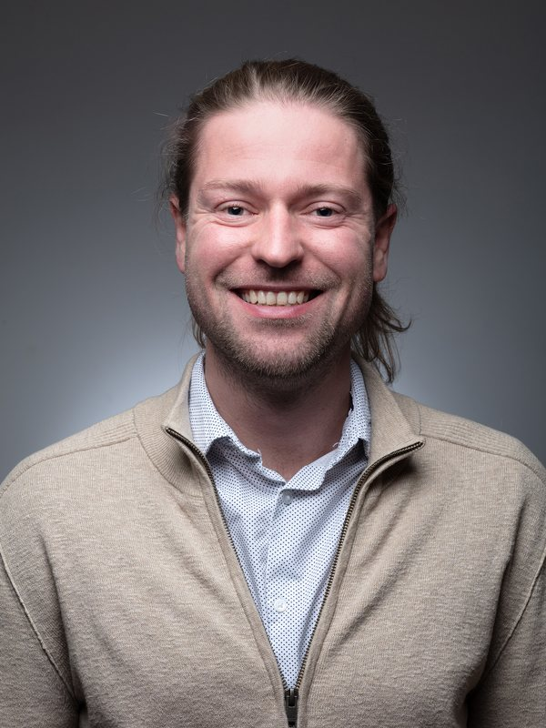
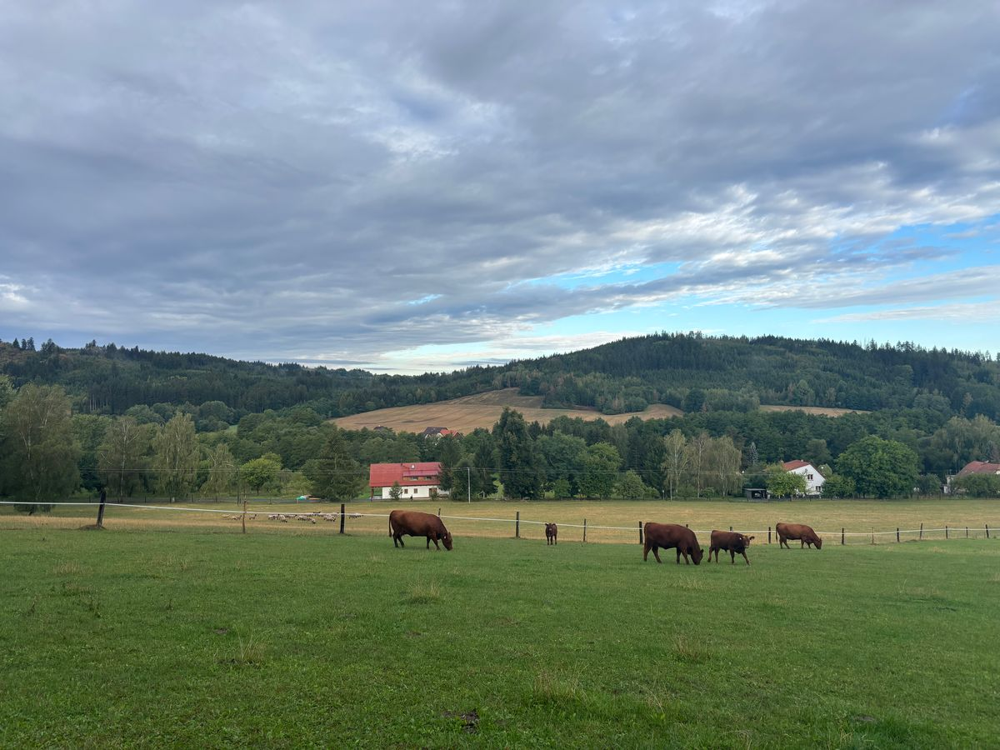
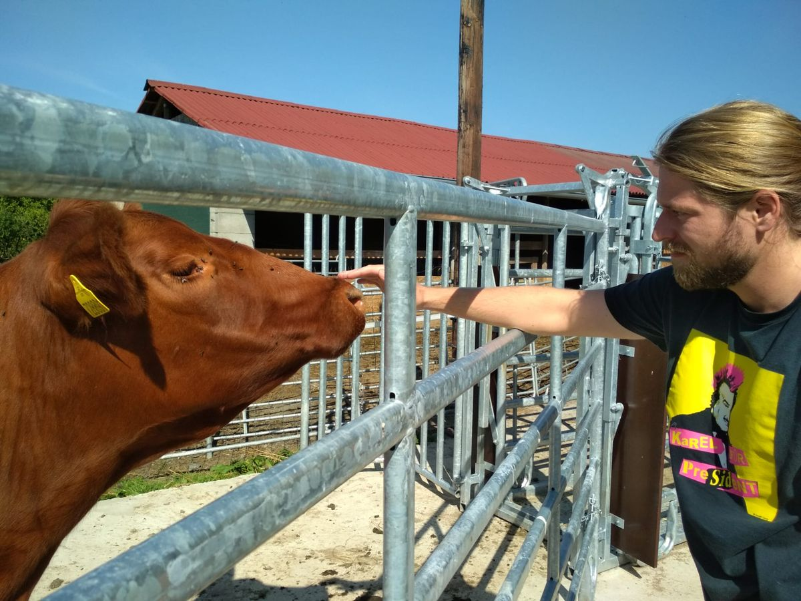

<!-- CONFIRM: the one-line lede, bio wording, research interests, the four numbers
     (the article count is computed from data/publications.yml) and the featured papers. -->

```{=html}
<section class="hero column-screen" aria-label="Introduction">
  <div class="hero-inner">
    <div class="hero-photo">
      
    </div>
    <div class="hero-main">
      <span class="eyebrow">Economist · Charles University, Prague</span>
      <h1>Matej Opatrny <span class="titles">MSc, PhD</span></h1>
      <p class="lede">Using the right <em>methods</em> to find out what the <em>data</em> really&nbsp;show.</p>
      <p class="bio">
        Matej Opatrny is an economist at the Institute of Economic Studies, Faculty of Social Sciences,
        Charles University, Prague, and a researcher at the Charles University Environment Centre.
        He is a positive economist: whatever the topic, the question is what the evidence actually
        supports. His toolkit includes meta-analysis, synthetic control,
        microsimulation and revealed-preference analysis, and his applications range from education,
        monetary policy and household welfare to energy and agricultural policy. His household
        microsimulation models provide analytical support to the Czech Ministry of the Environment and
        the Ministry of Agriculture. Outside academia, he has worked at McKinsey &amp; Company and as an
        economic analyst at Expobank.
      </p>
      <p class="bio">
        He also knows agricultural policy from the other side of the fence. Together with his parents,
        his brother and sister-in-law, he runs a small family farm of around 20 hectares in Šumava,
        where the cows are his own and looking after them is his job. He is married and has two
        children.
      </p>
      <div class="interests">
        <h2 class="interests-label">Research interests</h2>
        <div class="chips">
          <ul>
            <li>Meta-analysis and publication bias</li>
            <li>Policy evaluation and causal inference</li>
            <li>Microsimulation and distributional analysis</li>
            <li>Revealed preference and consumer demand</li>
            <li>Welfare measurement and inequality</li>
            <li>Applications: education, monetary, energy and agricultural policy</li>
          </ul>
        </div>
      </div>
    </div>
    <div class="hero-side">
      <ul class="affiliations">
        <li><i class="bi bi-bank" aria-hidden="true"></i><span><a href="https://ies.fsv.cuni.cz/contacts/institute-members/95950822">Institute of Economic Studies</a>, Faculty of Social Sciences, Charles University</span></li>
        <li><i class="bi bi-globe-europe-africa" aria-hidden="true"></i><span>Charles University Environment Centre</span></li>
        <li><i class="bi bi-megaphone" aria-hidden="true"></i><span>Founder, <a href="https://sciencecon.cz/en.html">Sciencecon</a></span></li>
        <li><i class="bi bi-people" aria-hidden="true"></i><span>Full member, <a href="https://cse.cz/en">Czech Economic Society</a></span></li>
        <li><i class="bi bi-award" aria-hidden="true"></i><span>Honourable mention, Young Economist of the Year 2016 · <a href="https://www.cnb.cz/cs/o_cnb/vlog-cnb/Autor-ocenene-prace-Matej-Opatrny-Me-propocty-ukazuji-na-priznivy-dopad-kurzoveho-zavazku">ČNB video interview</a></span></li>
      </ul>
      <div class="hero-actions">
        <a class="btn-primary-solid" href="files/cv.pdf"><i class="bi bi-file-earmark-arrow-down" aria-hidden="true"></i>Download CV</a>
        <a class="btn-outline" href="research.html">Research</a>
      </div>
      <span class="icon-row">
        <a class="icon-btn" href="#contact" aria-label="Email"><i class="bi bi-envelope" aria-hidden="true"></i></a>
        <a class="icon-btn" href="https://orcid.org/0000-0003-2322-6187" aria-label="ORCID"><i class="bi bi-orcid" aria-hidden="true"></i></a>
        <a class="icon-btn" href="https://scholar.google.com/citations?user=sQzpsG8AAAAJ" aria-label="Google Scholar"><i class="bi bi-google-scholar" aria-hidden="true"></i></a>
        <a class="icon-btn" href="https://ideas.repec.org/e/pop35.html" aria-label="RePEc / IDEAS"><i class="bi bi-ideas-repec" aria-hidden="true"></i></a>
      </span>
      <p class="contact-line" id="contact">
        <i class="bi bi-envelope" aria-hidden="true"></i>
        <a class="js-email" href="#contact">matej.opatrny [at] gmail [dot] com</a>
      </p>
    </div>
  </div>
</section>
```

::: {#stats}
:::

::: {.section-head}
## News

[All news →](news.qmd)
:::

::: {#news}
:::

::: {.section-head}
## Selected work

[All research →](research.qmd)
:::

::: {#featured}
:::

::: {.section-head}
## Beyond the university
:::

<!-- CONFIRM: Sciencecon text (from sciencecon.cz) and photo captions -->

```{=html}
<div class="beyond-grid">
  <article class="feature-card">
    <span class="eyebrow">Founder · Science communication</span>
    <h3>Sciencecon</h3>
    <p class="feature-quote" lang="cs">„Mít názor nestačí.“<span lang="en">Having an opinion is not enough.</span></p>
    <p>Researchers working in Czechia talk about their work directly with the public: two 20-minute
      talks and an open discussion, free entry. The pilot series started in Klatovy in March 2026,
      with Matej's opening talk on how class size affects pupils' results.</p>
    <a class="feature-link" href="https://sciencecon.cz/en.html">sciencecon.cz <span aria-hidden="true">→</span></a>
  </article>
  <figure class="photo-card">
    
    <figcaption><strong>The family farm</strong>On pasture in Šumava, the Bohemian Forest</figcaption>
  </figure>
  <figure class="photo-card">
    
    <figcaption><strong>His own herd</strong>With one of the cows</figcaption>
  </figure>
</div>
```

::: {#latest-notes}
:::
